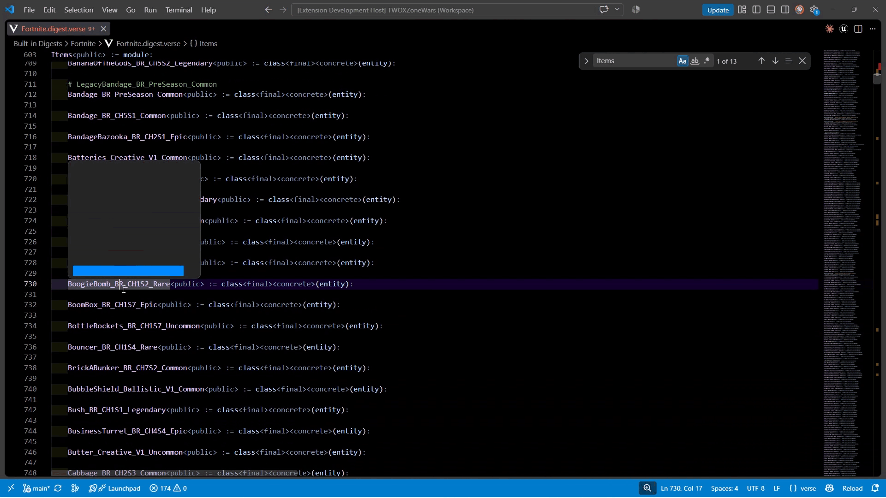

# VerseFNItemPreview



> [!IMPORTANT]
> This repo and project is independently created and is not affiliated, endorsed, or sponsored by Epic Games

## Features

Simple image preview for `Fortnite.digest.verse` exposed Fortnite item entities.

## Requirements

- Fortnite installed on Windows x64.
- Network access for initial Fortnite metadata and mappings retrieval.

## How It Works

1. The C# backend fetches keys + mappings through the publicly accessible [FortnitePorting](https://github.com/h4lfheart/FortnitePorting) API.
2. The backend then scans your installed Fortnite archives for items (consumables, weapons, traps, resources, etc) with the help of [CUE4Parse](https://github.com/FabianFG/CUE4Parse). This takes a few seconds on startup!
    > **NOTE:** You can see this process by navigating to `Output` tab/window in VSCode and change the channel to VerseFNItemPreview
3. The backend then writes an icon-only item index to the extension's storage directory. 
    - Definitions sharing a category, icon path, and equivalent display name are grouped. Each group retains its display name, icon paths, gameplay tags, and source asset names and paths.
    - This is useful for matching with Verse tokens in your code. 
4. When the extension detects a hover of a token in Verse it first verifies it's a reflected item (this is done through the [`data/item_image_binds.json`](data/item_image_binds.json) which is generated through the janky [`src/tools/generate_update_item_json.py`](src/tools/generate_update_item_json.py)...both are somewhat artifacts of a streaming based implementation, but it will do for now).
5. The extension uses [Levenshtein distance](https://github.com/ka-weihe/fastest-levenshtein) to compare the previously scanned local items with the token.
6. If it finds a match, it will send a request to the backend. The backend will check if a texture already exists (via hashing the name/path) and return it or export the one that exists.
7. The extension then previews with markdown.

## Extension Settings

Set `versefnitempreview.paksDirectory` to the Fortnite `Content/Paks` directory if your installation is outside the default Epic Games folder.

## GitHub Releases

The **Package VSIX** workflow builds a Windows x64 extension and attaches the `.vsix` to a GitHub Release when a version tag is pushed. The tag must match the version in `package.json`, for example:

```sh
git tag v0.0.1
git push origin v0.0.1
```

Commit and push the source changes, workflow, and tests before tagging. The workflow checks out CUE4Parse at the pinned revision in `.github/workflows/release.yml`, including its submodules, so the local `extern` directory does not need to be committed.

You can also run **Package VSIX** manually from the repository's Actions tab to download a build artifact. Manual runs on branches do not create a release. The workflow uses GitHub's built-in token and does not require a Marketplace token.

## Acknowledgements

Thanks to H4lfHeart for enlightening me on their FortnitePorting API! Their work on [FortnitePorting](https://github.com/h4lfheart/FortnitePorting) was also extremely useful in understanding more about CUE4Parse.

## Known Issues

- [`data/item_image_binds.json`](data/item_image_binds.json) is ran offline and requires me to update the git repository. In the future this will be a completely local operation.
- Scanning of archives takes a few seconds on startup.
- For some items that have different models/icons for rarity they display only one of the models.
- *(Not really an issue but more of a TODO)*: Only works for Fortnite items exposed with itemization. In the future it should allow for previewing thumbnails of any asset type.

<!-- ## Release Notes

Users appreciate release notes as you update your extension.

### 1.0.0

Initial release of ...

### 1.0.1

Fixed issue #.

### 1.1.0

Added features X, Y, and Z. -->

<!-- ---

## Following extension guidelines

Ensure that you've read through the extensions guidelines and follow the best practices for creating your extension.

* [Extension Guidelines](https://code.visualstudio.com/api/references/extension-guidelines) -->

